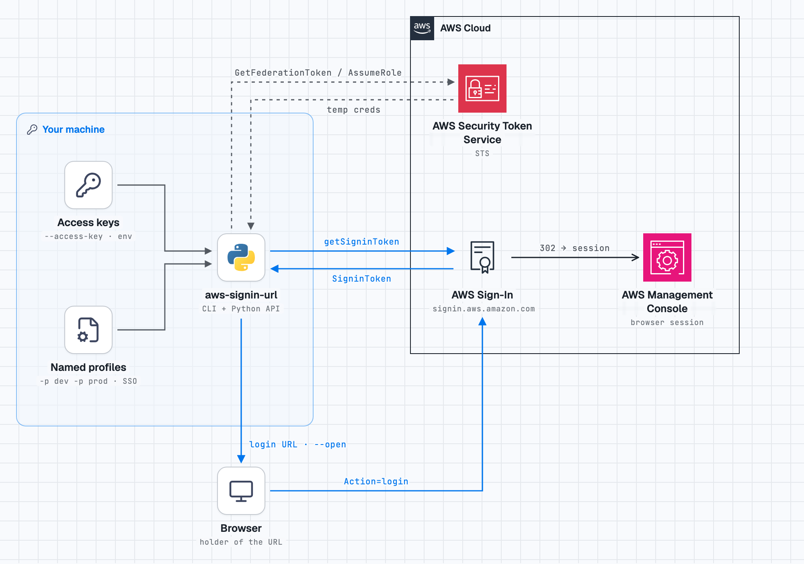

# aws-signin-url

Print a one-click **AWS Management Console sign-in URL** from AWS credentials:
IAM user access keys, a role, or any named profile.

```bash
pip3 install aws-signin-url
aws-signin-url -p dev
# https://signin.aws.amazon.com/federation?Action=login&Destination=...&SigninToken=...
```

## Architecture

<picture>
  <source media="(prefers-color-scheme: dark)" srcset="https://raw.githubusercontent.com/RajChowdhury240/aws-signin-url/main/docs/architecture-dark.png">
  
</picture>

## How it works

| Credentials you have                     | What the tool does                                  |
|------------------------------------------|-----------------------------------------------------|
| IAM user keys (`AKIA…`, no session token)| `sts:GetFederationToken` → temporary credentials    |
| Temporary keys (role, SSO, instance role)| used as-is                                          |
| Any of the above + `--role-arn`          | `sts:AssumeRole` first (MFA and external ID supported) |

The temporary credentials are then exchanged at the AWS federation endpoint
(`Action=getSigninToken`) for a sign-in token, and the tool prints the
`Action=login` URL. GovCloud (`us-gov-*`) and China (`cn-*`) regions use their own
partition's endpoints automatically.

## Usage

```bash
aws-signin-url                                   # default boto3 credential chain
aws-signin-url -p dev                            # named profile (SSO profiles work too)
aws-signin-url -p dev -p prod                    # one "profile<TAB>url" line per profile
aws-signin-url --all-profiles                    # every configured profile
aws-signin-url --list-profiles

aws-signin-url --access-key AKIA...              # prompts for the secret key
AWS_SECRET_ACCESS_KEY=... aws-signin-url --access-key AKIA...

aws-signin-url -p dev --role-arn arn:aws:iam::123456789012:role/Admin \
    --mfa-serial arn:aws:iam::111111111111:mfa/me   # prompts for the MFA code

aws-signin-url -p dev -s s3 -r eu-west-1 --open  # open the S3 console in eu-west-1
aws-signin-url -p dev --duration 3600            # 1-hour session
aws-signin-url -p dev --policy-arn arn:aws:iam::aws:policy/ReadOnlyAccess  # scope down
aws-signin-url -p dev --json                     # URL, identity ARN, expiry as JSON
```

The URL goes to stdout and status messages go to stderr, so
`aws-signin-url -p dev | pbcopy` copies just the link.

### Python API

```python
from aws_signin_url import generate_login_url

result = generate_login_url(profile="dev", service="cloudwatch", region="us-west-2")
print(result.url, result.credential_source, result.credentials_expire)
```

## Permissions and session length

- **IAM user keys** need `sts:GetFederationToken`. The default session policy is
  `Allow *:*`, but the session's permissions are the **intersection** of that policy and
  the user's own policies. It never grants more than the user already has. Pass
  `--policy` or `--policy-arn` to scope it down further. Duration: 900–129600 s, 12 h by
  default, 1 h maximum for root keys. The console session lasts as long as the token.
- **Roles** need `sts:AssumeRole` on the target role. `--duration` sets both the
  AssumeRole duration (bounded by the role's max session duration) and the console
  session (max 12 h). Role-chained sessions (role → role) max out at 1 h.
- **Federation tokens can't call IAM or STS APIs**, but in the console IAM works normally.

## Security notes

- **The printed URL is a bearer credential.** Anyone who opens it within 15 minutes gets
  the console session. Don't paste it into tickets, chat, or logs.
- Prefer the secret-key prompt or `AWS_SECRET_ACCESS_KEY` over `--secret-key`, which ends
  up in shell history and process listings.
- CloudTrail records `GetFederationToken` / `AssumeRole` and then a `ConsoleLogin` event
  for the federated user or assumed-role session.

## Development

```bash
pip install -e '.[test]'
pytest
python -m build        # sdist + wheel in dist/
```

## Author

Chowdhury Faizal Ahammed

License: MIT
